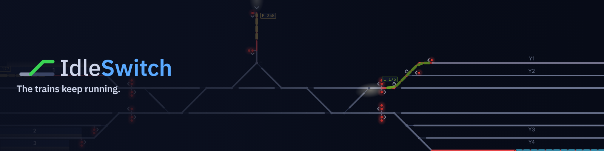

# IdleSwitch



**The trains keep running.**

Sit back and watch a CTC rail terminal run itself. A seeded terminal draws itself on a dark dispatcher's panel: track lights red under trains, signals step green, yellow, red behind them, switches throw, a yard breathes in and out. A virtual operator sets the routes. When you feel like it, take the panel and route trains yourself, NX-style; walk away and the operator takes it back. Nothing needs you and nothing punishes you for leaving. The same seed gives the same terminal and, at the same density and day length, the same day of traffic. Vanilla JS and canvas, no dependencies, no build step. Built to run at https://firetailfab.com/idleswitch/.

## Controls

| Key | Does |
|---|---|
| Space | Pause / resume |
| + / - | Faster / slower sim speed |
| A | Toggle AUTO / MANUAL |
| F, 0 | Reset the view: fit the terminal to the window |
| H | Hide all chrome for a bare panel |
| Esc | Clear the selection |
| 1 - 5 | Toggle panels: train board, log, inspector, legend, settings |
| ? | Toggle the legend |
| N | New random seed |

Mouse: drag to pan, wheel to zoom about the cursor. The HUD's − and + zoom about the middle of the map and ⌖ resets the view; they glide rather than jump, as F and 0 do. Click the seed in the HUD to type one in and load it (Enter), roll a new one or copy this one; Escape or a click elsewhere closes it. Drag the inner edge of a dock to resize it (double-click the edge for the default size); dock sizes are saved with the layout, and a floating panel resizes from its corner until reload.

Leave it alone for a minute and the idle camera takes over: it holds the overview, then follows a passing train or watches a mainline signal as trains run up to it, easing between shots with a caption in the corner. Any key, click or mouse move eases it home to the overview; the key or click that wakes it does nothing else.

To route a train, click an entrance signal, then an exit signal; the route sets if the interlocking allows, otherwise the entrance signal flashes red and the log says why. Click a train to pre-arm its next signal. Click a set, unoccupied route to cancel it. Click a free switch to throw it.

## What's on the panel

Track: grey is idle, green is a route set by the operator, blue is a route you set, red is occupied. The unset leg of a switch draws dim.

The panel runs a day of light every few minutes on the sim clock: dusk dims it a little, signal lamps and platforms glow, locos throw a headlight ahead, and the HUD's sun gives way to a moon. Passenger trains thin out at night and freight picks up. Every colour change fades rather than snaps, and the trailing end of a train carries a blinking red marker. Now and then a stretch of main gets a slow order: 20 mph, drawn amber with a `SLOW 20` label and logged, lifted after a few minutes. The operator setting the routes is named in the HUD and hands the desk over at each shift change (06:00, 14:00, 22:00), which the log notes.

Main 1 (upper) is home to westbound trains and Main 2 (lower) to eastbound, but both are signalled both ways, with a pair of crossovers in every gap between modules and at both ends. The operator may run a train on the other main round one that has stood a minute, returning it home at the first free pair; only one train runs on the wrong main at a time. A route into oncoming traffic is refused `opposing`, and one that would put a second train on the wrong main is refused `wrong main`; both show the usual red flash.

About three terminals in five have a wye in one gap between modules, a junction or a terminus by an even chance. A junction's two legs climb from Main 1 to a single-track branch that runs to a third portal at the top edge (or drop from Main 2 to the bottom edge). Trains come off the branch bound either way, and some trains leave by it; one bound for the branch from the other main crosses over in the gap to reach the foot of the wye. The branch carries one direction of flow at a time: while a departure waits to climb it, arrivals wait at the portal (ten minutes at most). There are no signals inside the junction gap, so a move through it is one route from a signal outside it. A departure for the branch runs in one route from the gap's boundary signal to the portal and never stands in the gap, so the few cells of wrong main it needs to reach the foot of the wye don't count against the one-train rule. Any other move on the other main inside the gap does count. An arrival that must cross to its home main is routed from the stem signal only as far as the gap's boundary signal, a few cells past the crossover, and while it waits there for the main ahead its tail can still stand across the other main. So it waits at the stem signal while another train is on the wrong main, and the log marks its route `(wrong main)`. A train bound for the branch that has stood ten minutes and is then refused its way up gives the branch up and runs for the far end (the log says it `missed` the branch).

A terminus wye makes the Tampa move. Its stem is a stub platform ending at a buffer stop, and passenger trains and expresses from either end call there. One pulls past the wye on the main and stops at the pull-ahead signal beyond it, then reverses and backs through the far leg into the stub, loco trailing, at 15 mph: the headlight is on the leading car and the red marker on the loco. After ten minutes at the platform it pulls out loco first by the other leg and runs back toward the portal it came from. There is one terminus visit at a time: the stub is offered only while it is free and no train for it is waiting, and while a terminus train that has not yet reversed is on the wye's main inside the gap, a route that would follow it in is refused `terminus`. Through trains cross the junction in one route from pull-ahead signal to pull-ahead signal, past the two shunt dwarfs at the feet (e.g. `E63Ks`, `W67Ks`), which give a reversed train its way into the stub. A terminus train that has waited twenty minutes to get into the gap gives the stub up and runs through.

Signal aspects (American practice):

| Name | High (1 head) | High (2 head) | Dwarf | Meaning |
|---|---|---|---|---|
| Clear | G | G / R | — | track speed |
| Approach | Y | Y / R | — | be prepared to stop at next signal; medium speed by then |
| Advance Approach / Approach Medium | flashing Y | flashing Y / R | — | next signal is Approach or shows a diverging aspect; slow to medium |
| Diverging Clear | — | R / G | — | medium through the turnout, then track speed |
| Diverging Approach | — | R / Y | — | medium through turnout, prepared to stop at next |
| Restricting | — | R / flashing R | flashing R | enter at restricted speed, prepared to stop short of anything |
| Slow Clear | — | — | G | proceed at slow speed |
| Stop | R | R / R | R | stop |

Signals are named by direction, column and row: `E12C` faces east at column 12 on row C (rows run A, B, C from the top), `W41Ad` is a westbound dwarf, `E63Ks` a terminus's shunt dwarf, and a branch's or a stub's signals face north or south (`S68B`).

Trains are a locomotive block plus one block per car, with an ID tag (type letter plus number; even eastbound, odd westbound):

| Letter | Type | Priority | Colour |
|---|---|---|---|
| X | Express | 5 | yellow |
| P | Passenger | 4 | amber |
| Z | Priority intermodal | 3 | purple |
| M | Manifest | 2 | blue |
| C | Unit coal | 1 | grey |
| G | Grain | 1 | orange |
| I | Intermodal | 1 | cyan |
| L | Local | 0 | green |

Higher priority wins when two trains want the same track.

## Seeds

`?seed=anything` loads that seed; the HUD shows the current one (click it to load another, roll a new one or copy it) and N rolls a new one. Same seed, same terminal; at the same density and day length, the same day of traffic. Density (light / normal / busy) is a setting in the HUD. `?ff=N` fast-forwards N sim seconds at boot (debug; used for headless screenshots).

## Settings

The Settings panel (5) holds sim speed, density, return to AUTO after 2 idle minutes, and whether flashing aspects flash; an Ambient group with the day length (2, 4 or 8 minutes, or off for always day), slow orders, and the idle camera (off by default when the system asks for reduced motion); Reset layout; and the seed. Settings and the panel layout are saved in the browser.

## Design notes

- Each main has a home direction, Main 1 westbound and Main 2 eastbound, and is signalled both ways; traffic locking keeps opposing trains out of the same stretch of main between crossover pairs. A meet is an overtake: the lower-priority train steps into a siding or yard track, or a train held behind a standing one passes it on the other main.
- Every track is a through track except a terminus's stub. Only a terminus train reverses, and it keeps its ID; every other train keeps its direction and ID from portal to portal.
- A switch is held by its trunk edge (occupied or routed) and by any set route through it that no train has entered yet; there is no flank protection.
- Yard tracks must be clear to receive a train.
- Human routes stand until a train takes them or you cancel them, with one exception: in AUTO the operator clears a human route no train can take 3 sim minutes after it was set. That is a route out of an empty track no train is bound for; into a track the train waiting at it doesn't fit; from a branch's stem signal against the direction of every train waiting there; a wrong-main route, or one from a signal on the other main, with no train standing at its signal; or one from a terminus's shunt dwarf with no train standing at it.
- Trains wait off-screen in a portal queue until a destination fits; the first eligible train in the queue enters, so one waiting for a full spur does not block the rest.

## Layout

```
index.html                  page shell
manage.sh                   dev server, tests, deploy
src/rng.js                  seeded PRNG
src/gen.js                  terminal generator
src/sim.js                  interlocking, routes, signals, trains, traffic
src/render.js               canvas renderer
src/camera.js               idle camera
src/ui.js                   app, HUD, panels, keybinds
src/ui-util.js              pure UI helpers
src/panels.js               panel bodies
src/style.css
tests/                      test_gen, test_sim, test_ui, test_camera (plain node)
.github/workflows/test.yml  CI
docs/superpowers/specs/     design spec
docs/superpowers/plans/     implementation plan
```

Design: [docs/superpowers/specs/2026-10-31-idleswitch-design.md](docs/superpowers/specs/2026-10-31-idleswitch-design.md). Plan: [docs/superpowers/plans/2026-10-31-idleswitch.md](docs/superpowers/plans/2026-10-31-idleswitch.md).

## Running it

```
./manage.sh start
```

Serves the repo root on http://localhost:8890 (override with `PORT=nnnn ./manage.sh start`). Also `stop`, `restart`, `status`, `logs`.

## Tests

```
./manage.sh test
```

Needs Node 22. No packages to install.

## Deploy

`./manage.sh deploy` rsyncs the repo root to firetailfab.com/idleswitch, minus dev-only files. Needs SSH access to the host (override the target with `DEPLOY_TARGET`).

## Status

v0.1. The seeded generator, interlocking, traffic, canvas panel, AUTO and MANUAL (NX) routing, dockable and resizable panels with a saved layout, the lighting cycle, slow orders, the junction and terminus wyes and the idle camera all work, with tests in CI. Later: an efficiency score for how well trains were routed (the sim already logs what it needs), sound, grade separation (crossings, diamonds, flyovers: its own spec), and light rail.

## License

MIT, see LICENSE.
